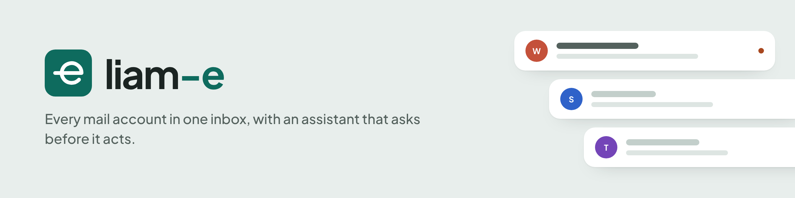

<h1>
  <picture>
    <source media="(prefers-color-scheme: dark)" srcset="docs/assets/readme-header-dark.png">
    
  </picture>
</h1>

liam-e brings multiple mail accounts together in one inbox. An AI assistant searches the mail
index, summarizes messages and drafts replies. You review its proposals in chat and decide
which to execute. The app has a German interface and is designed for one person per installation.

## What you can use

| Area | Current state |
| --- | --- |
| **Inbox and accounts** | Search, filter, read and manage mail in the inbox. Summaries and detected deadlines appear on the mail. Connection methods and actions depend on the provider. [Provider matrix](docs/providers-and-operations.md) |
| **Chat** | Search one account or all accounts, include a mail as context, choose the model and read streamed responses. Sending, replying, forwarding and changes by the assistant require explicit confirmation. Individual actions you initiate in the inbox take effect directly. [Chat and confirmation flow](docs/architecture.md#from-mail-sync-to-confirmation) |
| **Templates** | Manage your own instructions in settings and select them in chat. A conversation can stay pinned to a particular template revision. [Templates](docs/architecture.md) |
| **Tasks** | The API supports one-off and recurring tasks, due dates, previews and status changes. A task view and chat tools for tasks are not yet connected. [API contract](apps/api/openapi.json) |
| **Calendar** | The API reads the calendar index and manages existing sources. The agenda and connecting new sources are missing. An ICS adapter is implemented and tested, but not yet registered in the running service. [Calendar core](docs/architecture.md) |

Gmail and Outlook have paths through Studio connectors and own OAuth2. iCloud, Yahoo and other
providers can be connected through IMAP/SMTP when the provider supports app passwords and the
necessary mail protocols. The [provider and operations guide](docs/providers-and-operations.md) shows
which capabilities are evidenced locally and which still need Studio evidence. Model chat needs
server-side Mistral access.

## Start locally

The reference environment uses Bun 1.4.0, Node.js 24, uv, Python 3.14 and Postgres with pgvector.
Install dependencies from the repository root with `bun run install-all` and follow the
[local development](docs/local-development.md) guide for configuration and migrations. The
synthetic seed lets you see the UI without provider access or real mail.

After setup, start the API and web in two terminals from the repository root.

```bash
MAIL_WORKER_ENABLED=false MISTRAL_SECRETS_ENABLED=false TELEMETRY_ENABLED=false bunx nx run api:serve
VITE_API_URL=http://127.0.0.1:3000 bun run dev:web
```

The UI runs at [localhost:3001](http://localhost:3001). The
[health check](http://127.0.0.1:3000/api/health) is available directly on the API.

## Further documentation

- [Architecture and domains](docs/architecture.md)
- [Providers, synchronization and Studio deployment](docs/providers-and-operations.md)
- [Local development and checks](docs/local-development.md)
- [OpenWiki](openwiki/quickstart.md)
- [Contributing](CONTRIBUTING.md) and [security reporting](SECURITY.md)

The [minimal Mistral chat app](apps/chat-app/README.md) is a separate sub-application.
The mail app uses [`apps/web`](apps/web/) and [`apps/api`](apps/api/).

## License

There is no project-wide license file for liam-e. The license decision belongs to the owner.
Adopted components may have their own license terms. The
[publication checklist](docs/publishing.md) records the state of the planned publication.
