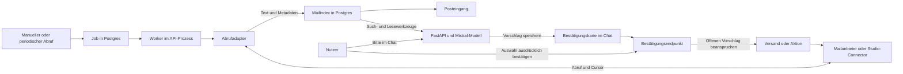

# Architektur

## Laufzeit und Schnittstellen

- **Web.** TanStack Start, Router und Query tragen die deutschsprachige Oberfläche. Der generierte API-Client verwendet standardmäßig dieselbe Origin wie die Seite. Für den lokalen Start setzt du den API-Ursprung ausdrücklich auf `http://127.0.0.1:3000`. [Webrouten](../apps/web/src/routes/_app/) · [Client-Konfiguration](../apps/web/src/api/client-config.ts) · [Lokale Entwicklung](lokale-entwicklung.md)
- **API.** FastAPI bindet den Routerbaum und die Start- und Shutdown-Hooks ein. Der OpenAPI-Vertrag enthält Pfade, Methoden, `operationId`s und Datenschemata. Die Client-Generierung gleicht ihn mit den Routen und dem Webclient ab. [FastAPI-Einstieg](../apps/api/src/api/main.py) · [Routerbaum](../apps/api/src/api/routers/) · [OpenAPI-Vertrag](../apps/api/openapi.json) · [Client-Generierung](../tools/gen-types.sh)
- **Datenbank und Worker.** Postgres speichert den Mailindex, den Chatverlauf und die weiteren Domänendaten. SQLModel-Modelle definieren die Tabellen, Accessors kapseln Abfragen und Änderungen, Alembic versioniert das Schema. Der Start-Hook startet den Worker im API-Prozess, wenn er aktiviert ist. Jobs bleiben in Postgres gespeichert. [Modelle](../packages/py/db/src/db/models/) · [Accessors](../packages/py/db/src/db/accessors/) · [Migrationen](../packages/py/db/src/db/migrations/) · [Start-Hook](../apps/api/src/api/lifespan/startup/mail_worker.py)
- **Studio.** Das Manifest beschreibt Web unter `/`, API unter `/api` und einen verwalteten Postgres-Dienst. Das Deployment begrenzt den Zugriff auf die Einzel-Nutzer-App. Die versionierte API besitzt keine eigene Nutzerverwaltung. [Manifest](../mistral.json) · [API-Zugriffsregel](../apps/api/src/api/routers/api/v1/__init__.py) · [Provider und Betrieb](provider-und-betrieb.md)

Die minimale Chat-App hat einen eigenen Node-Server und zeigt einen direkten Aufruf der Mistral API. Das Studio-Manifest enthält die Hauptanwendung aus `apps/web` und `apps/api`. [README der minimalen Chat-App](../apps/chat-app/README.md)

## Vom Mailabruf bis zur Bestätigung

1. **Abruf.** Ein manueller Abruf oder die periodische Prüfung reiht pro Konto deduplizierte Jobs ein. Der Worker wählt den Adapter anhand der Kontoanbindung. Der Sync-Dienst aktualisiert indexierte Mails und speichert den Cursor je Konto. Bei neuen Mails reiht der Worker einen Job für fehlende Kurzfassungen ein. Der Volltextindex umfasst Betreff, Absender und aufbereiteten Mailtext. [Worker](../apps/api/src/api/mail/jobs.py) · [Sync-Dienst](../apps/api/src/api/mail/sync.py) · [Textaufbereitung](../apps/api/src/api/mail/sync_types.py) · [Volltextindex](../packages/py/db/src/db/models/mail_message.py)
2. **Lesen und vorschlagen.** Der Chat-Stream liefert typisierte Server-Sent Events. Der Agent speichert den Verlauf und arbeitet mit einem pro Turn festgehaltenen Kontoumfang. Seine Werkzeuge durchsuchen den Posteingang, lesen Mails, holen Kurzfassungen und legen Vorschläge für Versand, Archiv, Papierkorb, Gelesen-Markierung oder Newsletter-Abbestellung an. Für den Versand umfasst der Entwurf auch Antworten, Antworten an alle und Weiterleitungen. [Chat-Stream](../apps/api/src/api/routers/api/v1/chat/stream.py) · [Agent](../apps/api/src/api/mail/agent.py) · [Werkzeuge](../apps/api/src/api/mail/agent_tools.py)
3. **Ausführen.** Die Vorschlagskarte sendet die ausdrückliche Auswahl an die Bestätigungsroute. Ein bedingtes Datenbank-Update setzt den offenen Vorschlag auf `running`, wenn sein etwaiger Turn-Kontext noch gültig ist. Erst danach führt der Vorschlagsdienst den Versand oder die Aktion aus und speichert das Ergebnis je Eintrag. Abbrechen verwirft einen offenen Vorschlag. Direkt vom Nutzer ausgelöste Einzelaktionen im Posteingang gehen über die Mail-Aktionsroute und bieten „Rückgängig“ für unterstützte Aktionen. [Vorschlagskarte](../apps/web/src/chat/ProposalCard.tsx) · [Bestätigungsroute](../apps/api/src/api/routers/api/v1/chat/proposals.py) · [Statuswechsel](../packages/py/db/src/db/accessors/chat_message.py) · [Vorschlagsdienst](../apps/api/src/api/mail/proposals.py) · [Mail-Aktionsroute](../apps/api/src/api/routers/api/v1/mail/messages.py) · [Rückgängig](../apps/api/src/api/mail/actions.py)

## Daten und Funktionsgrenzen

| Bereich | Persistenz und aktuelle Oberfläche |
| --- | --- |
| **Mail** | `mail_account`, `mail_credential`, `mail_sync_state` und `mail_job` halten Verbindung und Abrufzustand. `mail_message`, `mail_insight` und `mail_action` speichern Index, Kurzfassungen und Aktionshistorie für „Rückgängig“. Die Mailansicht zeigt Text und Anhangsmetadaten. Ein Anhangsdownload steht aus. Original und Kopfzeilen werden bei unterstützten Konten beim Anbieter abgerufen und bleiben außerhalb des Index. Die Webliste zeigt den Posteingang. Die API erlaubt auch Abfragen der lokal indexierten Archiv- und Papierkorb-Zeilen. [Mailansicht](../apps/web/src/mail/MailView.tsx) · [Originalabruf](../apps/api/src/api/mail/original.py) · [Mail-API](../apps/api/src/api/routers/api/v1/mail/messages.py) |
| **Chat und Vorlagen** | `chat_conversation`, `chat_message` und `chat_context` speichern Verlauf, Vorschläge und den aufgelösten Kontext eines Turns. Die Vorlagenbibliothek erlaubt Anlegen, Bearbeiten und Löschen. `prompt_template` verweist auf die aktuelle `prompt_revision`, während die Auswahl im Chat an einer konkreten Revision hängt. Der Agent übergibt die Vorlage als Nutzerinhalt. Löschen entfernt den Vorlageninhalt, setzt betroffene Auswahlen zurück und widerruft die zugehörigen Turn-Kontexte. [Vorlagenbibliothek](../apps/web/src/prompts/Library.tsx) · [Vorlagenauswahl](../apps/web/src/prompts/TemplateMenu.tsx) · [Versionsverwaltung](../packages/py/db/src/db/accessors/prompt_template.py) |
| **Kalender** | `calendar_source`, `calendar_event`, `calendar_occurrence` und `calendar_sync_state` speichern Quellen, Ereignisse, Instanzen und Abdeckung. Kalenderrouten lesen den Index, verwalten bestehende Quellen und reihen einen manuellen Abruf ein. Der Synchronisierungsdienst verarbeitet vollständige Snapshots über einen registrierten Adapter. Der ICS-Adapter mit isolierter Verarbeitung ist implementiert und getestet. Anbieterregistrierung beim Start, Anlegen einer Quelle über die API, periodischer Abruf, Kalenderoberfläche und Kalenderwerkzeuge im Chat stehen aus. [Kalenderrouten](../apps/api/src/api/routers/api/v1/calendar/) · [Snapshot-Abruf](../apps/api/src/api/calendar/sync.py) · [ICS-Adapter](../apps/api/src/api/calendar/ics.py) · [ICS-Tests](../apps/api/tests/test_calendar_ics_parse.py) |
| **Aufgaben** | `task_series`, `task_schedule_revision` und `task_occurrence` trennen Serie, Zeitplan und konkrete Fälligkeit. Die API bietet Anlage, Vorschau, Lesen, Terminverschiebung, Archivierung und Löschung sowie Erledigen, Überspringen und Wiederöffnen von Instanzen. Reconcile materialisiert Fälligkeiten seitenweise. Leseaufrufe arbeiten auf gespeicherten Daten. Aufgabenoberfläche und Werkzeuge im Chat stehen aus. [Aufgaben-API](../apps/api/src/api/routers/api/v1/tasks/) · [Reconcile](../apps/api/src/api/tasks/reconcile.py) |

Unter Einstellungen ist die Vorlagenbibliothek der verfügbare Bereich. Die Darstellung bleibt als Browserpräferenz gespeichert. Eine serverseitige Konfiguration der Wischaktionen steht aus. [Einstellungen](../apps/web/src/prompts/Settings.tsx) · [Darstellung](../apps/web/src/shell/theme.ts)

## Agenten und Studio

Die Werkzeuge des internen Mailassistenten sind in `agent_tools.py` definiert. Ein Studio-HTTP-Connector ist ein eigener Integrationsweg. Beim Import kann jede Operation des importierten OpenAPI-Vertrags als MCP-Werkzeug erscheinen. Für diesen Weg gilt die Lesefreigabe in `AGENTS.md`. Der Inventurtest gleicht die Erlaubnisliste mit den API-Operationen ab. Eine separate MCP-Lese-API steht aus. [Interne Werkzeuge](../apps/api/src/api/mail/agent_tools.py) · [Lesefreigabe](../AGENTS.md#sicherheit) · [Inventurtest](../apps/api/tests/test_mcp_exposure.py)

Die Oberflächenspezifikation vom 13. November 2026 dokumentiert den damaligen Entwurf. Die Studio-Proben vom selben Tag halten Gateway- und Connector-Verhalten zum Zeitpunkt der Messung fest. [Oberflächenregeln](../DESIGN.md) · [Historische Oberflächenspezifikation](superpowers/specs/2026-11-13-oberflaeche-und-mail-aktionen-design.md) · [Studio-Proben](superpowers/probes/2026-11-13-studio-proben.md) · [Lokale Entwicklung](lokale-entwicklung.md)
